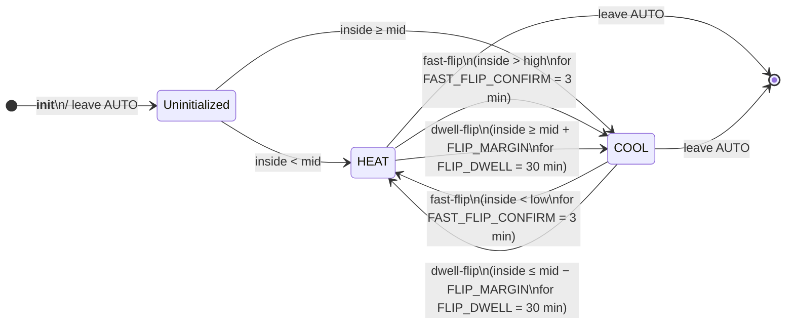

# Comfort Thermostat — AUTO mode state machine

Reference for the current AUTO-mode behavior of `climate.comfort_thermostat`.
Two layers compose:

1. **Direction commitment** (`_auto_mode`) — sticky HEAT or COOL choice
   that flips on demand mismatch.
2. **Unit command** — the mode and setpoint sent to the wrapped device:
   the committed direction, with a setpoint at the matching band edge.

Other HVAC modes (`OFF`, `HEAT`, `COOL`) pass through to the wrapped
device unchanged; the state machines below only apply when the wrapper
is in `AUTO`.

---

## Layer 1 — Direction commitment

`_auto_mode` is `None` after init / leaving AUTO.  On the first sensor
tick in AUTO it commits to either `HEAT` or `COOL` based on inside-vs-
midpoint of the active comfort band.  Once committed, it flips only on
genuine demand mismatch — by one of two mechanisms:

Both flips also wait until `MIN_CHANGEOVER_INTERVAL` (10 min) has passed
since the previous AUTO changeover, so the reversing valve can't
ping-pong.  The initial pick doesn't count as a changeover.

### Why two flip mechanisms

`FLIP_DWELL = 30 min` is sized for **sensor jitter / natural drift near
the midpoint**.  When inside oscillates around `mid ± FLIP_MARGIN`,
30-minute sustained pressure tells you "this is real demand, not noise".

But the dwell is the wrong filter when inside is **already past the
band edge** — there's no jitter explanation for `inside > high` while
HEAT is committed.  That's a wrong commitment, not noise.  Fast-flip
catches it after a short confirmation, so a single bad reading (e.g. a
Z-Wave sensor re-initialising) can't reverse the heat pump.

| Mechanism | Trigger | Latency |
|---|---|---|
| **Fast-flip** | Wrong direction + inside past band edge (`HEAT & inside > high`, or `COOL & inside < low`) | `FAST_FLIP_CONFIRM` (3 min) |
| **Dwell-flip** | Wrong direction + inside past `mid ± FLIP_MARGIN` but still in band | `FLIP_DWELL` (30 min) |

### Initial-pick rule (`_auto_mode == None`)

Inside-vs-midpoint, full stop.  Outside sensor is **not** consulted —
empirically the outside reading doesn't correlate with the building's
thermodynamics in this deployment, and using it caused live HEAT-at-23
bugs (see [PR #62](https://github.com/HomeOps/HASS-Smart-Climate/pull/62)).
Outside sensor remains a valid config option for display / future use.

### No reading

If there is no usable inside reading (sensor unavailable, unparsable or
implausible), AUTO makes no decision: a committed direction is held and
the device command stays put.  With no committed direction either, the
device is left untouched and `problems` reports `auto_waiting_for_reading`.

---

## Layer 2 — Unit command

The wrapper sends the committed direction and never commands OFF in
AUTO.  The setpoint is **asymmetric**, because the Midea unit holds the
room at or slightly above its setpoint (up to about +0.5 °C) in both
modes:

| Committed | Setpoint sent | Room held at | `[21, 23]` example |
|---|---|---|---|
| HEAT | `low` | `low` … `low + 0.5` | setpoint 21, room ~21–21.5 |
| COOL | `high - 1` | `high - 1` … `high - 0.5` | setpoint 22, room ~22–22.5 |

COOL can't use `high`: the positive overshoot would hold the room above
the band.  Between the two ranges (21.5–22 above) neither mode actively
pumps; the unit idles on its own setpoint logic.

Setpoints are sent in **whole degrees of the Home Assistant system
unit** (°C or °F), rounded toward the inside of the band: up for HEAT,
down for COOL.  `MIN_TEMP_DIFF` (1.5 °C) is the narrowest band where that
rounding plus the overshoot still lands in band.

### Why the setpoint, not wrapper cycling, controls idle

Upstream v3.0.x – v4.0.x had the wrapper turn the unit OFF inside the
band during COOL (deliberate-OFF) to avoid the Midea **COOL
minimum-frequency floor**.  Measured on 2026-05-02, that cycling drew
~50× the power of simply letting the unit hold `high - 1`, and it was
removed in v5.0.0.  With the band-edge setpoint the unit never enters
the low-load regime that triggers the floor.

See [`CLAUDE.md`](../CLAUDE.md#midea-unit-behaviour--empirical-notes)
for the unit observations and the design history.

---

## Composing the layers

Per sensor tick:

1. If `_auto_mode is None`: pick HEAT or COOL by inside-vs-mid.
2. **Fast-flip check**: if committed direction is wrong AND inside is
   past the band edge for `FAST_FLIP_CONFIRM`, flip `_auto_mode` (subject
   to `MIN_CHANGEOVER_INTERVAL`).
3. **Dwell-flip check**: update `_pending_flip_since` based on `mid ±
   FLIP_MARGIN` deviation; flip `_auto_mode` if sustained for 30 min
   (subject to `MIN_CHANGEOVER_INTERVAL`).
4. **Unit command**: the committed direction with its band-edge setpoint.
5. **Send to device**: only call `set_temperature` when the unit's
   reported mode or setpoint differs from the desired one.

`hvac_action` mirrors the unit's own action (`heating`, `cooling`,
`idle`, `off`, …).

### When the device drifts

The wrapper is the only writer of the device's mode and setpoint.  If the
device stops matching the last command, the wrapper re-sends it:

| Situation | Re-sent |
|---|---|
| Device back from unavailable (power blip) | Immediately |
| Setpoint differs, or the command never landed | After `COMMAND_GRACE_SECONDS` (60 s) |
| Device was in the commanded mode, then something else changed it (IR remote) | After that mode has run `MIN_CHANGEOVER_INTERVAL` (10 min), so the compressor isn't short-cycled |

At most `MAX_DRIFT_RESENDS` (3) re-sends in a row; after that
`command_desync` stays in `problems`.

---

## Problem detection (`problems` attribute)

The wrapper continuously checks for failure modes the state machine
itself can't fix.  See [`CLAUDE.md` → Problem detection](../CLAUDE.md#problem-detection-problems-attribute)
for the conditions and thresholds.

`problems` is a list of short codes — empty `[]` when healthy, e.g.
`["out_of_band:42min", "short_cycle:8/h"]` when not.  Templates can
key off `length > 0` for notifications.

---

## Constants

All thresholds live in [`const.py`](../custom_components/comfort_thermostat/const.py):

| Constant | Default | Purpose |
|---|---|---|
| `FLIP_MARGIN` | 0.5 °C | Past midpoint to count as wrong-side |
| `FLIP_DWELL` | 1800 s (30 min) | Sustained-excursion threshold for dwell-flip |
| `FAST_FLIP_CONFIRM` | 180 s (3 min) | How long a band-edge violation must hold before fast-flip |
| `MIN_CHANGEOVER_INTERVAL` | 600 s (10 min) | Minimum spacing between AUTO changeovers; also how long a remote-set mode runs before it's undone |
| `MIN_TEMP_DIFF` | 1.5 °C | Narrowest allowed comfort band |
| `INSIDE_TEMP_PLAUSIBLE_MIN` / `_MAX` | 0 / 45 °C | Inside readings outside this range count as no reading |
| `COMMAND_GRACE_SECONDS` | 60 | Time for the device to follow a command before desync / re-send |
| `MAX_DRIFT_RESENDS` | 3 | Re-sends in a row before giving up |
| `OUT_OF_BAND_ALERT_MINUTES` | 30 | When AUTO can't keep room in band |
| `SHORT_CYCLE_THRESHOLD_PER_H` | 6 | Compressor starts/h above this is a problem |
| `SENSOR_STALE_MINUTES` | 15 | Inside-sensor freshness threshold |
